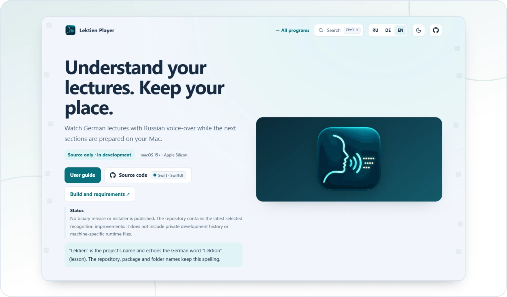

<!-- ppk-readme:head:start -->
<a href="https://popovantondev.github.io/LektienPlayer/index-en.html"><picture><source media="(prefers-color-scheme: dark)" srcset="https://raw.githubusercontent.com/popovantondev/LektienPlayer/main/docs/readme/header-en-dark.4ff5561f.svg"></picture></a>
<!-- ppk-readme:head:end -->

# Lektien Player

[Русский](README.ru.md) · [Deutsch](README.md) · **English**

<!-- ppk-readme:body:start -->

<a href="https://github.com/popovantondev/LektienPlayer"><picture><source media="(prefers-color-scheme: dark)" srcset="https://raw.githubusercontent.com/popovantondev/LektienPlayer/main/docs/readme/btn-source-en-dark.8779d112.svg"></picture></a>
<a href="https://popovantondev.github.io/LektienPlayer/index-en.html"><picture><source media="(prefers-color-scheme: dark)" srcset="https://raw.githubusercontent.com/popovantondev/LektienPlayer/main/docs/readme/btn-website-en-dark.1cfa1b62.svg"></picture></a>
<a href="https://popovantondev.github.io/LektienPlayer/Guide-en.html"><picture><source media="(prefers-color-scheme: dark)" srcset="https://raw.githubusercontent.com/popovantondev/LektienPlayer/main/docs/readme/btn-guide-en-dark.c1a2d232.svg"></picture></a>
<a href="https://github.com/popovantondev/LektienPlayer/issues/new"><picture><source media="(prefers-color-scheme: dark)" srcset="https://raw.githubusercontent.com/popovantondev/LektienPlayer/main/docs/readme/btn-bug-en-dark.9d56fd9f.svg"></picture></a>

<a href="https://popovantondev.github.io/LektienPlayer/index-en.html"><picture><source media="(prefers-color-scheme: dark)" srcset="https://raw.githubusercontent.com/popovantondev/LektienPlayer/main/docs/readme/preview-en-dark.02f927b1.webp"></picture></a>

<picture><source media="(prefers-color-scheme: dark)" srcset="https://raw.githubusercontent.com/popovantondev/LektienPlayer/main/docs/readme/divider-dark.b8314084.svg"></picture>
<!-- ppk-readme:body:end -->

<!-- public-release:start -->
Lecture player for Mac: local German speech recognition, translation and Russian Kseniya voice-over in sections. Telegram streaming and home-network viewing.

**macOS 15+ · Apple Silicon · Source only · in development**

**[Source](https://github.com/popovantondev/LektienPlayer)** · **[About the app](https://popovantondev.github.io/LektienPlayer/index-en.html)** · **[User guide](https://popovantondev.github.io/LektienPlayer/Guide-en.html)** · **[Report a problem](https://github.com/popovantondev/LektienPlayer/issues/new)**

**Requirements and limitations:** Source only; no ready-to-install package. macOS 15+, Apple Silicon, Xcode 16.4+ / Swift 6.1. Full functionality needs a separate Runtime, Codex CLI signed in to ChatGPT, and Python/Torch/Silero Kseniya. Installation on a clean Mac is not yet verified.

**First steps:** Read the guide and BUILD.en.md. Compile using swift build; a complete .app needs prepared Runtime components. Open a video, choose subtitles or a German audio track, then start translation.
<!-- public-release:end -->

“Lektien” is the project’s name and echoes the German word “Lektion” (lesson). The repository, package and folder names keep this spelling.

No binary release or installer is published. The repository contains the latest selected recognition improvements; it does not include private development history or machine-specific runtime files.

## What it does

- Local MP4/M4V/MKV playback, embedded audio and text subtitle selection, adjacent SRT discovery.
- German speech recognition in sections, translation with saved text caches, and local Russian Silero Kseniya synthesis.
- Separate voice volume, original-audio ducking, subtitle styling and three control-panel layouts.
- Telegram byte-range streaming and browser viewing over the same home network.
- M4A/SRT export and MP4/MKV with separate Russian and German tracks; video copied without re-encoding when supported.

## Current limitations

- Current processing direction is German → Russian; interface languages are DE/EN/RU. Other voices and translation directions are planned.
- The browser waits for a 200-second speech reserve at startup or after a distant seek; near the end it uses the remaining duration. Manual pause keeps preparing ahead.
- One remote viewer/preparation session; long real-device and weak-Wi-Fi tests remain necessary. Safari HTTPS-only mode may block the local HTTP address.
- OCR, screen capture, live Zoom/Teams translation and a Windows-native application are not implemented.
- Pronunciation and recognition can contain errors. No accuracy, medical interpretation or seamless playback guarantee is made.

## Data and privacy

Speech recognition and synthesis run locally. Translation sends prepared subtitle text to the signed-in service. Telegram requests use your own authorized session. Credentials are stored separately on the Mac. Source recordings are preserved; cache data is stored in .lektien. Only share the chosen library on a trusted home network; do not forward its port to the Internet.

[Build and requirements](docs/BUILD.en.md) · [Architecture](docs/ARCHITECTURE.en.md) · [Third-party notices](docs/DEPENDENCIES.en.md)

## Rights and use

Rights and use: [RIGHTS.md](RIGHTS.md). The source code is public for viewing; no open-source license is granted. Third-party components keep their own terms ([THIRD_PARTY.md](THIRD_PARTY.md)).
