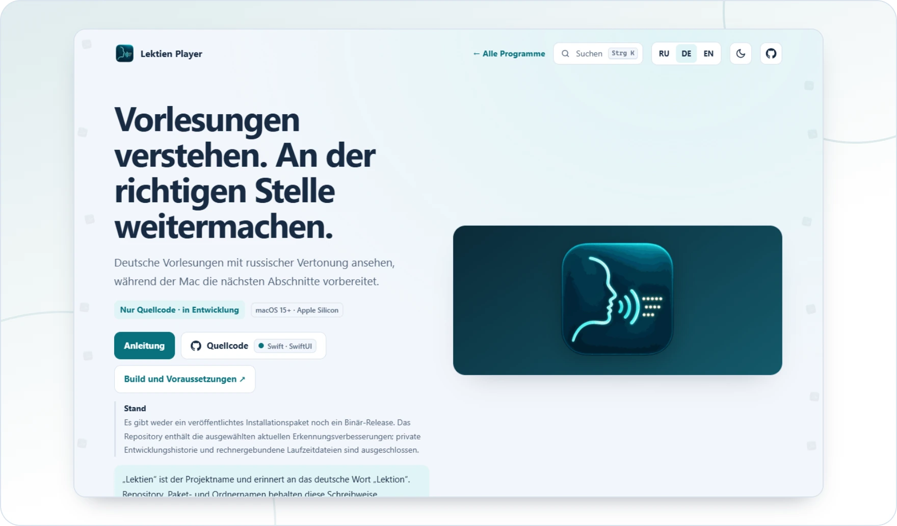

<!-- ppk-readme:head:start -->
<a href="https://popovantondev.github.io/LektienPlayer/index.html"><picture><source media="(prefers-color-scheme: dark)" srcset="https://raw.githubusercontent.com/popovantondev/LektienPlayer/main/docs/readme/header-de-dark.7d743091.svg"></picture></a>
<!-- ppk-readme:head:end -->

# Lektien Player

[Русский](README.ru.md) · **Deutsch** · [English](README.en.md)

<!-- ppk-readme:body:start -->

<a href="https://github.com/popovantondev/LektienPlayer"><picture><source media="(prefers-color-scheme: dark)" srcset="https://raw.githubusercontent.com/popovantondev/LektienPlayer/main/docs/readme/btn-source-de-dark.dfa90318.svg"></picture></a>
<a href="https://popovantondev.github.io/LektienPlayer/index.html"><picture><source media="(prefers-color-scheme: dark)" srcset="https://raw.githubusercontent.com/popovantondev/LektienPlayer/main/docs/readme/btn-website-de-dark.2880dbd7.svg"></picture></a>
<a href="https://popovantondev.github.io/LektienPlayer/Guide-de.html"><picture><source media="(prefers-color-scheme: dark)" srcset="https://raw.githubusercontent.com/popovantondev/LektienPlayer/main/docs/readme/btn-guide-de-dark.243ee643.svg"></picture></a>
<a href="https://github.com/popovantondev/LektienPlayer/issues/new"><picture><source media="(prefers-color-scheme: dark)" srcset="https://raw.githubusercontent.com/popovantondev/LektienPlayer/main/docs/readme/btn-bug-de-dark.1098fda6.svg"></picture></a>

<a href="https://popovantondev.github.io/LektienPlayer/index.html"><picture><source media="(prefers-color-scheme: dark)" srcset="https://raw.githubusercontent.com/popovantondev/LektienPlayer/main/docs/readme/preview-de-dark.7f60bb5a.webp"></picture></a>

<picture><source media="(prefers-color-scheme: dark)" srcset="https://raw.githubusercontent.com/popovantondev/LektienPlayer/main/docs/readme/divider-dark.b8314084.svg"></picture>
<!-- ppk-readme:body:end -->

<!-- public-release:start -->
Vorlesungsplayer für den Mac: lokale Erkennung deutscher Sprache, Übersetzung und russische Kseniya-Vertonung in Abschnitten. Telegram und Wiedergabe im Heimnetz.

**macOS 15+ · Apple Silicon · Nur Quellcode · in Entwicklung**

**[Quellcode](https://github.com/popovantondev/LektienPlayer)** · **[Über die App](https://popovantondev.github.io/LektienPlayer/index.html)** · **[Anleitung](https://popovantondev.github.io/LektienPlayer/Guide-de.html)** · **[Fehler melden](https://github.com/popovantondev/LektienPlayer/issues/new)**

**Voraussetzungen und Grenzen:** Nur Quellcode, kein fertiges Installationspaket. macOS 15+, Apple Silicon, Xcode 16.4+ / Swift 6.1. Für alle Funktionen sind ein separates Runtime-Paket, Codex CLI mit ChatGPT-Anmeldung sowie Python/Torch/Silero Kseniya erforderlich. Die Installation auf einem frisch eingerichteten Mac ist noch nicht geprüft.

**Erste Schritte:** Zuerst Anleitung und BUILD.de.md lesen. Quellcode mit swift build kompilieren; eine vollständige .app benötigt vorbereitete Runtime-Komponenten. Video öffnen, Untertitel oder eine deutsche Tonspur wählen und Übersetzung starten.
<!-- public-release:end -->

„Lektien“ ist der Projektname und erinnert an das deutsche Wort „Lektion“. Repository, Paket- und Ordnernamen behalten diese Schreibweise.

Es gibt weder ein veröffentlichtes Installationspaket noch ein Binär-Release. Das Repository enthält die ausgewählten aktuellen Erkennungsverbesserungen; private Entwicklungshistorie und rechnergebundene Laufzeitdateien sind ausgeschlossen.

## Funktionen

- Lokale MP4/M4V/MKV-Wiedergabe, Auswahl eingebetteter Ton- und Textuntertitelspuren sowie Erkennung benachbarter SRT-Dateien.
- Abschnittsweise Erkennung deutscher Sprache, Übersetzung mit Textcache und lokale russische Silero-Kseniya-Synthese.
- Separate Lautstärke der Vertonung, Absenkung des Originaltons, Untertitelgestaltung und drei Bedienleisten-Modi.
- Telegram-Streaming über Byte-Bereiche und Browserwiedergabe im selben Heimnetz.
- M4A/SRT-Export und MP4/MKV mit separaten russischen und deutschen Spuren; Videokopie ohne Neukodierung bei kompatiblem Format.

## Aktuelle Grenzen

- Aktuell wird Deutsch → Russisch verarbeitet; die Oberfläche bietet DE/EN/RU. Weitere Stimmen und Übersetzungsrichtungen sind geplant.
- Der Browser wartet beim Start und nach einem weiten Sprung auf 200 Sekunden Sprachpuffer; am Ende zählt die verbleibende Dauer. Während einer manuellen Pause wird weiter vorbereitet.
- Eine entfernte Wiedergabe-/Vorbereitungssitzung; lange Tests auf echten Geräten und bei schwachem WLAN stehen noch aus. Safaris HTTPS-only-Modus kann lokale HTTP-Adressen blockieren.
- OCR, Bildschirmaufnahme, Live-Übersetzung von Zoom/Teams und eine native Windows-App sind nicht implementiert.
- Erkennung und Aussprache können Fehler enthalten. Genauigkeit und lückenlose Wiedergabe auf beliebigen Geräten werden nicht garantiert.

## Daten und Datenschutz

Erkennung und Synthese laufen lokal. Für die Übersetzung wird vorbereiteter Untertiteltext an den angemeldeten Dienst übermittelt. Telegram verwendet die eigene autorisierte Sitzung. Zugangsdaten verbleiben separat auf dem Mac. Quelldateien bleiben erhalten; der Cache liegt in .lektien. Die ausgewählte Bibliothek nur im vertrauenswürdigen Heimnetz freigeben und den Port nicht ins Internet weiterleiten.

[Build und Voraussetzungen](docs/BUILD.de.md) · [Architektur](docs/ARCHITECTURE.de.md) · [Drittkomponenten](docs/DEPENDENCIES.de.md)

## Rechte und Nutzung

Rechte und Nutzung: [RIGHTS.de.md](RIGHTS.de.md). Der Quellcode ist zur Ansicht öffentlich; eine Open-Source-Lizenz wird nicht erteilt. Für Drittkomponenten gelten deren eigene Bedingungen ([THIRD_PARTY.md](THIRD_PARTY.md)).
