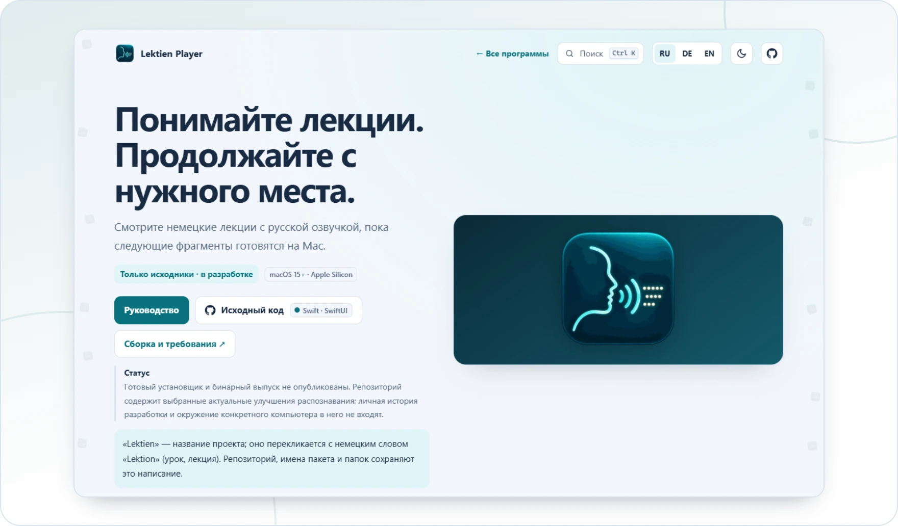

<!-- ppk-readme:head:start -->
<a href="https://popovantondev.github.io/LektienPlayer/index-ru.html"><picture><source media="(prefers-color-scheme: dark)" srcset="https://raw.githubusercontent.com/popovantondev/LektienPlayer/main/docs/readme/header-ru-dark.0712b896.svg"></picture></a>
<!-- ppk-readme:head:end -->

# Lektien Player

**Русский** · [Deutsch](README.md) · [English](README.en.md)

<!-- ppk-readme:body:start -->

<a href="https://github.com/popovantondev/LektienPlayer"><picture><source media="(prefers-color-scheme: dark)" srcset="https://raw.githubusercontent.com/popovantondev/LektienPlayer/main/docs/readme/btn-source-ru-dark.45bae1df.svg"></picture></a>
<a href="https://popovantondev.github.io/LektienPlayer/index-ru.html"><picture><source media="(prefers-color-scheme: dark)" srcset="https://raw.githubusercontent.com/popovantondev/LektienPlayer/main/docs/readme/btn-website-ru-dark.1c112626.svg"></picture></a>
<a href="https://popovantondev.github.io/LektienPlayer/Guide-ru.html"><picture><source media="(prefers-color-scheme: dark)" srcset="https://raw.githubusercontent.com/popovantondev/LektienPlayer/main/docs/readme/btn-guide-ru-dark.0cab15fc.svg"></picture></a>
<a href="https://github.com/popovantondev/LektienPlayer/issues/new"><picture><source media="(prefers-color-scheme: dark)" srcset="https://raw.githubusercontent.com/popovantondev/LektienPlayer/main/docs/readme/btn-bug-ru-dark.37017457.svg"></picture></a>

<a href="https://popovantondev.github.io/LektienPlayer/index-ru.html"><picture><source media="(prefers-color-scheme: dark)" srcset="https://raw.githubusercontent.com/popovantondev/LektienPlayer/main/docs/readme/preview-ru-dark.f0a696bd.webp"></picture></a>

<picture><source media="(prefers-color-scheme: dark)" srcset="https://raw.githubusercontent.com/popovantondev/LektienPlayer/main/docs/readme/divider-dark.b8314084.svg"></picture>
<!-- ppk-readme:body:end -->

<!-- public-release:start -->
Плеер лекций для Mac: локальное распознавание немецкой речи, перевод и русская озвучка Kseniya по частям. Telegram и просмотр в домашней сети.

**macOS 15+ · Apple Silicon · Только исходники · в разработке**

**[Исходники](https://github.com/popovantondev/LektienPlayer)** · **[О программе](https://popovantondev.github.io/LektienPlayer/index-ru.html)** · **[Инструкция](https://popovantondev.github.io/LektienPlayer/Guide-ru.html)** · **[Сообщить об ошибке](https://github.com/popovantondev/LektienPlayer/issues/new)**

**Требования и ограничения:** Только исходники, готового установщика нет. macOS 15+, Apple Silicon, Xcode 16.4+ / Swift 6.1. Для полной работы нужны отдельный Runtime, Codex CLI с входом ChatGPT и Python/Torch/Silero Kseniya. Установка на чистый Mac пока не проверена.

**Первые шаги:** Прочитайте руководство и BUILD.ru.md. Соберите исходники через swift build; полная .app требует подготовленных компонентов Runtime. Откройте видео, выберите субтитры или немецкую звуковую дорожку и запустите перевод.
<!-- public-release:end -->

«Lektien» — название проекта; оно перекликается с немецким словом «Lektion» (урок, лекция). Репозиторий, имена пакета и папок сохраняют это написание.

Готовый установщик и бинарный выпуск не опубликованы. Репозиторий содержит выбранные актуальные улучшения распознавания; личная история разработки и окружение конкретного компьютера в него не входят.

## Возможности

- Локальное воспроизведение MP4/M4V/MKV, выбор встроенного звука и текстовых субтитров, поиск соседних SRT.
- Распознавание немецкой речи по частям, перевод с сохранением текста в кэше и локальная русская озвучка Silero Kseniya.
- Отдельная громкость озвучки, приглушение оригинала, оформление субтитров и три режима панели управления.
- Потоковое видео из Telegram по диапазонам и просмотр через браузер в общей домашней сети.
- Экспорт M4A/SRT и MP4/MKV с отдельными русскими и немецкими дорожками; копирование видео без перекодирования, если формат совместим.

## Текущие ограничения

- Сейчас обработка идёт с немецкого на русский; интерфейс доступен на DE/EN/RU. Другие голоса и направления перевода запланированы.
- Браузер ждёт 200 секунд запаса речи при старте или дальней перемотке; у конца учитывает оставшуюся длительность. На ручной паузе подготовка продолжается.
- Одна удалённая сессия просмотра и подготовки; длительные проверки на реальных устройствах и слабом Wi-Fi ещё нужны. Режим HTTPS-only Safari может блокировать локальный HTTP-адрес.
- OCR, захват экрана, прямой перевод Zoom/Teams и нативная версия Windows не реализованы.
- В распознавании и произношении возможны ошибки. Точность и бесшовность на любых устройствах не гарантируются.

## Данные и приватность

Распознавание и синтез выполняются локально. Для перевода подготовленный текст субтитров передаётся сервису с вашим входом. Telegram использует вашу авторизованную сессию. Учётные данные остаются отдельно на Mac. Исходные записи сохраняются; кэш находится в .lektien. Раздавайте выбранную библиотеку только в доверенной домашней сети и не открывайте порт в Интернет.

[Сборка и требования](docs/BUILD.ru.md) · [Архитектура](docs/ARCHITECTURE.ru.md) · [Сторонние компоненты](docs/DEPENDENCIES.ru.md)

## Права и использование

Права и использование: [RIGHTS.ru.md](RIGHTS.ru.md). Исходный код открыт для просмотра; открытая лицензия не предоставляется. У сторонних компонентов сохраняются их собственные условия ([THIRD_PARTY.md](THIRD_PARTY.md)).
